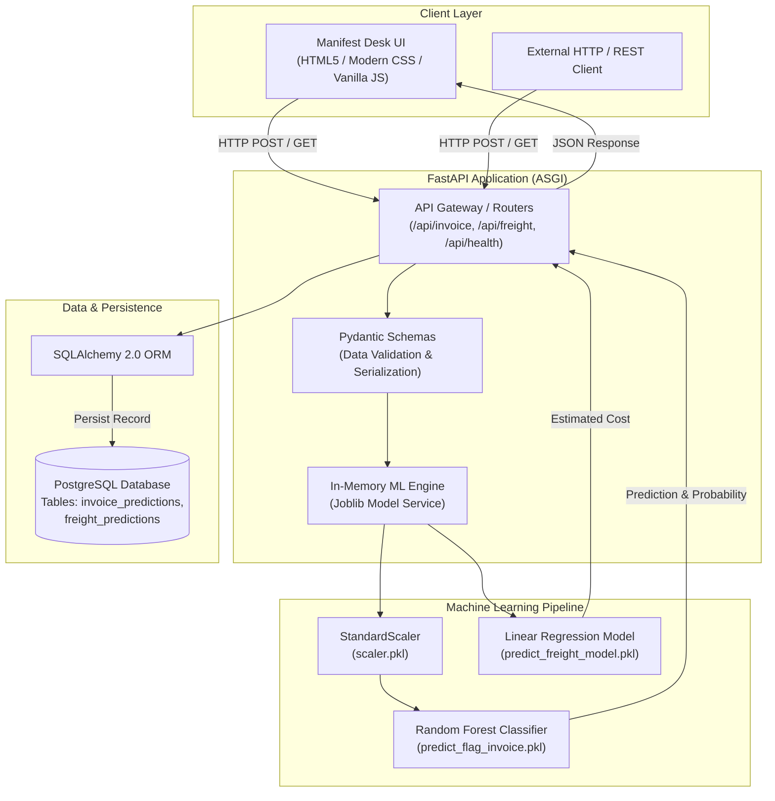

# Vendor Intelligence — Manifest Desk

<div align="center">

[](https://www.python.org/)
[](https://fastapi.tiangolo.com/)
[](https://scikit-learn.org/)
[](https://www.postgresql.org/)
[](https://www.sqlalchemy.org/)

**An intelligent, machine learning-driven procurement auditing system for real-time invoice risk classification and predictive freight cost estimation.**

[Overview](#-overview) • [Key Features](#-key-features) • [System Architecture](#-system-architecture) • [ML Pipelines](#-machine-learning-pipelines) • [Tech Stack](#-tech-stack) • [API Reference](#-api-reference) • [Getting Started](#-getting-started) • [Project Structure](#-project-structure)

</div>

---

## 📌 Overview

In enterprise procurement and supply chain management, invoice discrepancy detection and freight cost validation are typically manual, error-prone, and slow. Discrepancies between purchase orders (PO), billed quantities, and invoiced freight charges lead to revenue leakage, accounting bottlenecks, and vendor compliance violations.

**Vendor Intelligence** solves this through a dual-model predictive architecture:
1. **Invoice Anomaly & Fraud Detection**: An ensemble classifier evaluates incoming invoices against historical purchase orders, outputting an instant audit verdict (`CLEARED` or `FLAGGED`) paired with calibrated risk confidence scores.
2. **Predictive Freight Estimation**: A regression model projects expected shipping and logistics charges from billed dollar amounts to identify overcharges before payment authorization.
3. **Audit Trail Persistence**: Every transaction and prediction is automatically logged into a relational PostgreSQL database via SQLAlchemy ORM, ensuring end-to-end traceability for compliance audits.

---

## ✨ Key Features

- **⚡ Sub-Millisecond Model Inference**: Pre-trained estimators and feature scalers are loaded into memory during application boot, eliminating per-request cold-start latency.
- **🛡️ Strict Data Validation**: Strict type enforcement, bounds checking, and schema validation on all inputs using **Pydantic v2**.
- **📊 Real-time Audit Trail**: Automatic database logging of every check with timestamps, input features, classification flags, and probabilities for historical auditing.
- **🎨 Responsive "Manifest Desk" Dashboard**: A lightweight, zero-build frontend styled with an editorial manifest aesthetic, dynamic connection health indicators, and an interactive ledger table.
- **📖 Self-Documenting REST API**: Interactive OpenAPI/Swagger documentation (`/docs`) and ReDoc (`/redoc`) generated directly from API routers.
- **🔒 Secure Environment Architecture**: Decoupled environment variable management with `.env` and `pydantic-settings` to prevent credential exposure.

---

## 🏗️ System Architecture



---

## 🧠 Machine Learning Pipelines

### 1. Invoice Risk Classifier (`predict_flag_invoice.pkl` + `scaler.pkl`)
- **Objective**: Flag suspicious invoices or reconciliation errors between billed invoice data and warehouse receipt purchase orders.
- **Algorithm**: Random Forest Classifier.
- **Preprocessing**: Feature standardisation via `StandardScaler`.
- **Feature Vector**:
  - `invoice_quantity`: Billed item quantity.
  - `invoice_dollars`: Total dollar amount billed on invoice.
  - `Freight`: Freight charges billed on invoice.
  - `total_item_quantity`: Total physical units confirmed received on PO.
  - `total_item_dollars`: Total dollar value confirmed received on PO.
- **Output**:
  - Binary decision: `0` (CLEARED) or `1` (FLAGGED).
  - Risk Probability: Calibrated model confidence score ($0.0 \to 1.0$).

### 2. Freight Cost Regressor (`predict_freight_model.pkl`)
- **Objective**: Forecast acceptable freight charges based on shipment invoice volume to benchmark vendor transport costs.
- **Algorithm**: Regression Model.
- **Feature**: `Dollars` (Invoice dollar amount).
- **Output**: Predicted freight expenditure in USD ($).

---

## 💻 Tech Stack

| Domain | Technologies Used | Description |
|---|---|---|
| **Backend Framework** | [FastAPI](https://fastapi.tiangolo.com/), [Uvicorn](https://www.uvicorn.org/) | High-performance asynchronous REST API framework |
| **Validation & Config** | [Pydantic v2](https://docs.pydantic.dev/), [pydantic-settings](https://docs.pydantic.dev/latest/concepts/pydantic_settings/) | Strict data parsing, request validation, and environment configuration |
| **Machine Learning** | [Scikit-Learn](https://scikit-learn.org/), [NumPy](https://numpy.org/), [Pandas](https://pandas.pydata.org/), [Joblib](https://joblib.readthedocs.io/) | Model training, serialization, feature transformation, and inference |
| **Database & ORM** | [PostgreSQL](https://www.postgresql.org/), [SQLAlchemy 2.0](https://www.sqlalchemy.org/), [psycopg2-binary](https://www.psycopg.org/) | Relational database with automatic table creation & ORM mappings |
| **Frontend** | HTML5, CSS3 (CSS Grid & Flexbox), Vanilla JavaScript (ES6+) | Manifest Desk interface; zero bundler required, mounted by FastAPI |
| **API Standards** | OpenAPI 3.0, Swagger UI, ReDoc, CORS Middleware | Industry-standard documentation and secure cross-origin communication |

---

## 📡 API Reference

Interactive documentation is available at `http://localhost:8000/docs` once the server is started.

### Endpoints Overview

| Method | Endpoint | Description | Request Body | Response |
|---|---|---|---|---|
| `GET` | `/api/health` | Service health check | None | `{"status": "ok"}` |
| `POST` | `/api/invoice/predict` | Classify invoice risk & save to DB | `InvoiceInput` | `InvoicePredictionOut` |
| `GET` | `/api/invoice/history` | Retrieve recent scored invoices | Query: `limit` (default: 20) | `List[InvoicePredictionOut]` |
| `POST` | `/api/freight/predict` | Estimate freight charges & save to DB | `FreightInput` | `FreightPredictionOut` |
| `GET` | `/api/freight/history` | Retrieve recent freight estimates | Query: `limit` (default: 20) | `List[FreightPredictionOut]` |

---

### Request & Response Examples

#### 1. Score an Invoice (`POST /api/invoice/predict`)

**Request Payload:**
```json
{
  "invoice_quantity": 6000.0,
  "invoice_dollars": 58000.0,
  "Freight": 300.0,
  "total_item_quantity": 6000.0,
  "total_item_dollars": 58000.0
}
```

**Response Payload (`200 OK`):**
```json
{
  "id": 1,
  "invoice_dollars": 58000.0,
  "freight": 300.0,
  "predicted_flag": 0,
  "risk_label": "CLEARED",
  "risk_probability": 0.04,
  "created_at": "2026-11-12T13:00:00Z"
}
```

#### 2. Estimate Freight Cost (`POST /api/freight/predict`)

**Request Payload:**
```json
{
  "Dollars": 25000.0
}
```

**Response Payload (`200 OK`):**
```json
{
  "id": 1,
  "dollars": 25000.0,
  "predicted_freight": 284.50,
  "created_at": "2026-11-12T13:00:00Z"
}
```

---

## 🚀 Getting Started

Follow these instructions to get a local copy running for development and evaluation.

### Prerequisites

- **Python**: Version `3.10` or higher
- **PostgreSQL**: Version `14` or higher installed and running locally (or remote connection)
- **Git**

---

### Step 1: Clone the Repository

```bash
git clone https://github.com/smithaherkar/vendor-intelligence.git
cd vendor-intelligence
```

---

### Step 2: Configure Database

1. Open a terminal and create the PostgreSQL database:
   ```bash
   psql -U postgres
   ```
   ```sql
   CREATE DATABASE vendor_intelligence;
   \q
   ```
   *(Note: You do not need to create tables manually. The application automatically initialises all required tables via SQLAlchemy upon startup).*

2. Create your `.env` configuration file from the template:
   ```bash
   cd backend
   cp .env.example .env
   ```

3. Update `.env` with your local PostgreSQL credentials:
   ```ini
   POSTGRES_USER=postgres
   POSTGRES_PASSWORD=your_real_password
   POSTGRES_HOST=localhost
   POSTGRES_PORT=5432
   POSTGRES_DB=vendor_intelligence
   ```

---

### Step 3: Set Up Python Environment

From inside the `backend/` directory:

```bash
# Create virtual environment
python -m venv venv

# Activate virtual environment
# On macOS / Linux:
source venv/bin/activate

# On Windows (Command Prompt):
venv\Scripts\activate.bat
# On Windows (PowerShell):
venv\Scripts\Activate.ps1

# Upgrade pip and install dependencies
pip install --upgrade pip
pip install -r requirements.txt
```

---

### Step 4: Run the Application

Start the Uvicorn ASGI server:

```bash
uvicorn app.main:app --reload
```

The terminal will confirm the server is running:
```text
INFO:     Uvicorn running on http://127.0.0.1:8000 (Press CTRL+C to quit)
```

---

### Step 5: Access the Application

- **Web Dashboard**: Open [`http://localhost:8000`](http://localhost:8000) in your browser.
- **Interactive Swagger Docs**: Open [`http://localhost:8000/docs`](http://localhost:8000/docs).
- **Alternative ReDoc Docs**: Open [`http://localhost:8000/redoc`](http://localhost:8000/redoc).

---

## 📂 Project Structure

```text
vendor_intelligence/
├── backend/
│   ├── app/
│   │   ├── __init__.py
│   │   ├── main.py              # Application factory, middleware & router mounting
│   │   ├── config.py            # Environment settings and paths (Pydantic Settings)
│   │   ├── database.py          # SQLAlchemy engine, session maker & declarative base
│   │   ├── models_db.py         # PostgreSQL ORM table schemas
│   │   ├── schemas.py           # Pydantic request / response validation models
│   │   ├── ml_models.py         # ML runtime loader and inference functions
│   │   └── routers/
│   │       ├── __init__.py
│   │       ├── invoice.py       # Endpoints: /api/invoice/predict & /api/invoice/history
│   │       └── freight.py       # Endpoints: /api/freight/predict & /api/freight/history
│   ├── models/                  # Serialized ML artifacts (.pkl)
│   │   ├── predict_flag_invoice.pkl   # Trained Random Forest Classifier
│   │   ├── predict_freight_model.pkl  # Trained Freight Regression Model
│   │   └── scaler.pkl                 # StandardScaler feature preprocessor
│   ├── .env.example             # Configuration template
│   └── requirements.txt         # Pinned backend dependencies
│
├── frontend/                    # Manifest Desk static web application
│   ├── index.html               # Main dashboard UI
│   ├── css/
│   │   └── style.css            # Ledger typography & responsive grid styles
│   └── js/
│       └── app.js               # Async fetch calls, UI stamps, and dynamic DOM rendering
│
├── .gitignore                   # Version control exclusion rules
└── README.md                    # Project documentation
```

---

## 📐 Engineering Practices & Design Highlights

- **Separation of Concerns**: Modular decoupling between data serialization (`schemas.py`), persistence (`models_db.py`), domain logic (`ml_models.py`), and transport layer (`routers/`).
- **Memory & Latency Optimization**: Avoids expensive disk I/O per request by initializing ML models in memory at startup.
- **Zero-Build Frontend Architecture**: The dashboard is served directly through FastAPI static file mounting, enabling instant deployment without npm/webpack complexity.
- **Fail-Safe Predictions**: Clear exception handling with HTTP 500 error propagation and transactional database commits with session rollbacks.

---

## 🔮 Future Enhancements

- [ ] **Containerization**: Add multi-stage `Dockerfile` and `docker-compose.yml` for unified backend, database, and test orchestration.
- [ ] **CI/CD Pipeline**: Automated GitHub Actions workflows for flake8 linting, mypy type verification, and pytest unit testing.
- [ ] **Model Versioning & Experiment Tracking**: Integrate MLflow / DVC for tracking model iterations, metrics, and dataset provenance.
- [ ] **RBAC & Auth**: Add OAuth2 / JWT authentication to secure prediction endpoints and audit log modifications.

---

## 👤 Author

**Smith Aherkar**
- GitHub: [@smithaherkar](https://github.com/smithaherkar)
- Repository: [vendor-intelligence](https://github.com/smithaherkar/vendor-intelligence)
